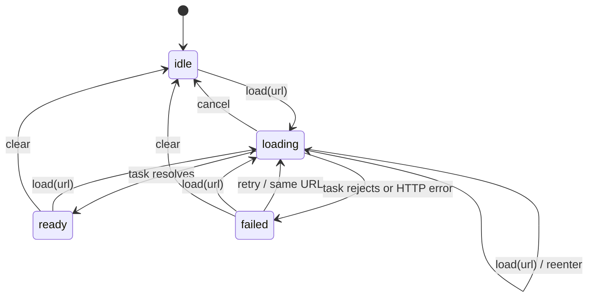

# Request lifetimes

[`request.machine.ts`](request.machine.ts) is a compiled, reusable request statechart. It uses existing tasks and `reenter`; no extra cancellation manager or request counter is needed. Define the machine at module scope, then create independent actors from it. Configure the [state compiler plugin](../README.md) in the consuming application as usual. These source examples are in the repository, not new package exports.



`load` during loading explicitly reenters the state, even for the same URL. Leaving that task lifetime aborts its signal. A normal transition that keeps the current state does not restart the task. `fetch` receives the signal; an SDK operation that cannot accept it may continue doing work, but its late success or rejection cannot transition this actor after cancellation, replacement, or stop. The [regressions](../test/request-lifecycle.test.ts) deliberately use an operation that ignores abort.

Cancellation does not undo external effects. Check the signal before subsequent side effects inside an asynchronous task, and use server-side idempotency where the application requires it. The example reads text and retries only after an explicit `retry` event; it does not automatically retry writes. HTTP failures and network rejections enter `failed`. A new load discards the previous result; retaining stale data while refreshing is an application policy.

## A request owned by one view

```ts
import { useActor } from "@reactre/state/signals";
import { requestMachine } from "./request.machine.ts";

// Inside a Reactre component/root:
const [snapshot, actor] = useActor(requestMachine);
actor.send({ type: "load", url: "/api/status" });
// Read snapshot() in reactive UI expressions.
```

`useActor` already unsubscribes and stops the actor during owner cleanup. Its pending task is aborted. Remounting creates a new actor in `idle`; a late completion from the disposed actor cannot update the remounted view. Do not add a second actor-cleanup wrapper.

## A request owned by a cache

[`cached-request.ts`](cached-request.ts) is a small controller factory using `createActor`, `subscribe`, and a signal. The factory intentionally has explicit disposal: the cache, rather than whichever view happens to create it, owns its lifetime.

```ts
import { createCachedRequest } from "./cached-request.ts";

const cached = createCachedRequest(); // create once for a cache entry
cached.actor.send({ type: "load", url: "/api/status" });
// Views read cached.snapshot() in reactive UI expressions.
// Unmounting a view removes that view's reactive subscriptions, not the cached actor.
// A later view reads the same controller, including work completed between mounts.

cached.dispose(); // cache eviction or application shutdown
```

Do not register `cached.dispose` with each view's `onCleanup`. On eviction, `dispose` unsubscribes the snapshot bridge and stops the actor, aborting outstanding work. Disposal is idempotent; the stopped controller must be replaced if the cache entry is loaded again. Choose an explicit cache eviction/shutdown policy so unused actors do not live indefinitely. Cache keys, retention, authorization changes, transport normalization, and invalidation belong to the application.

The machine keeps URLs and text in JSON contracts. Abort controllers, promises, responses, and transport handles live only in task execution, never in snapshots. This example deliberately does not add persistence or restart in-flight network requests after hydration.

## Evidence and coverage

This extracts lifecycle lessons from Herdsman's actor-owned web state without copying its domain adapters. The inspected reference was `746020adc19a1367e885cdd9ba9beacf3c4de135` in the `reactre-state-migration/herdsman` worktree, including `docs/adr/0036-actor-owned-web-state.md` and `web/src/state/`. Its uncommitted compiler/benchmark edits are separate evidence, not part of that revision. The reference was read only.

Run `bun test packages/state/test/request-lifecycle.test.ts`. It compiles the actual example and checks rapid reentry, stale success and rejection, cancellation, HTTP/network failure, explicit retry, replacement, clearing, view cleanup/remount, and cached controller disposal. Existing runtime behavior supplies all of these guarantees; this change adds examples and regressions only.
